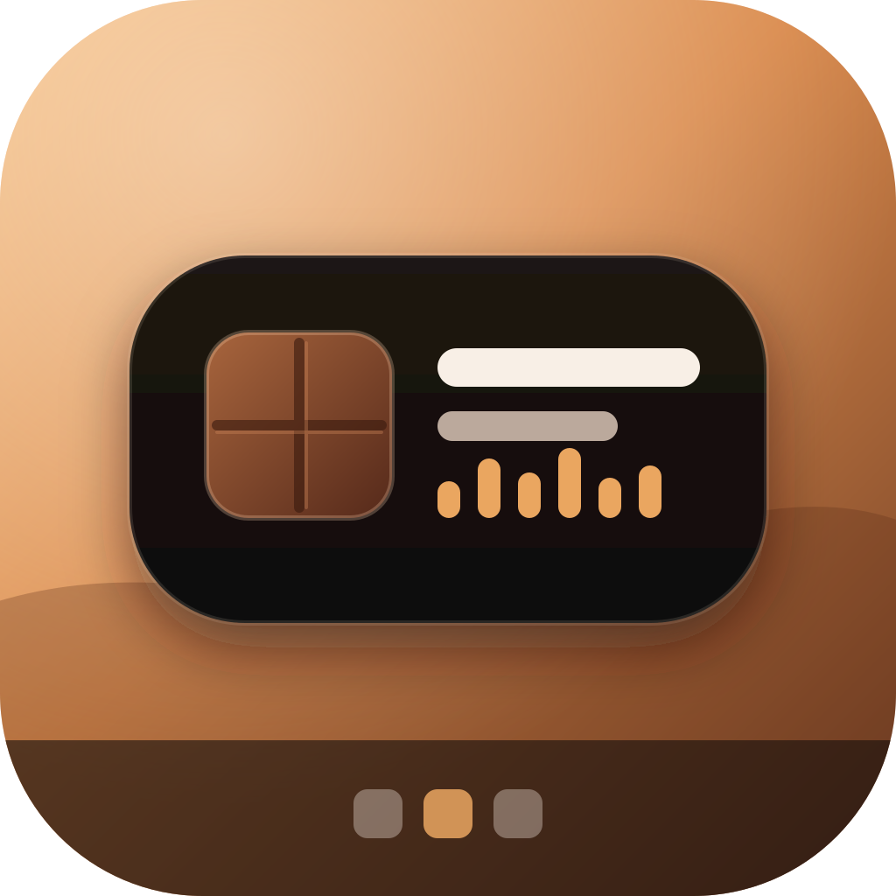
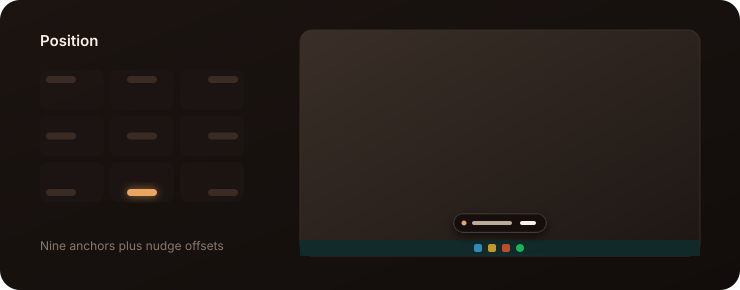

<div align="center">



# ChocolateBar

**A Dynamic Island for Windows.** A small pill that lives above your taskbar and opens into live cards for music, calls, timers, downloads, Claude Code and more.

[](https://github.com/AbdulghaniKM/ChocolateBar/releases/latest)
[](https://github.com/AbdulghaniKM/ChocolateBar/releases)




</div>

## Download

Grab **`ChocolateBar_x.y.z_x64-setup.exe`** from the [latest release](https://github.com/AbdulghaniKM/ChocolateBar/releases/latest) and run it. No admin rights are needed, and WebView2 is installed automatically if it's missing.

ChocolateBar **updates itself**. About 15 seconds after launch it installs any newer release, and while running it checks every 6 hours and offers new versions from the tray menu.

## What it shows

| Activity | In the island |
| --- | --- |
| **Media** | Artwork, seek bar, play/pause/skip, shuffle and repeat, synced lyrics, and an audio visualizer. Works with Spotify and browser tabs (YouTube in Chrome, Brave, Edge or Firefox), and lets you switch between them. |
| **Claude Code** | Live session state, the current tool, model and permission mode. Approve or deny permission requests right from the island. |
| **Volume & brightness** | Replaces the Windows volume flyout. |
| **Privacy** | Lights up while an app uses your microphone or camera. Mute the mic with <kbd>Ctrl</kbd>+<kbd>Alt</kbd>+<kbd>M</kbd>. |
| **Battery & Bluetooth** | Charging animation, low-battery alerts, and battery levels for headphones, mice and controllers. Galaxy Buds get per-bud levels and noise control. |
| **Timer** | Focus (Pomodoro), stopwatch with laps, and quick countdowns. |
| **Downloads & games** | Browser downloads plus Steam and Epic installs, and playtime tracking. |
| **Weather & sports** | Current conditions with rain and storm warnings, and live scores for the leagues and teams you follow. |
| **Text capture** | <kbd>Ctrl</kbd>+<kbd>Alt</kbd>+<kbd>O</kbd>, drag a box, and the recognized text lands on your clipboard. |
| **File shelf** | Drop files on the island to park them, and drag them back out later. |
| **Keyboard & network** | Input-language and Caps Lock changes, Wi-Fi and VPN events, and live up/down speed. |

## Using it

- **Click** the pill to open it.
- **Right-click**, press <kbd>Esc</kbd>, or use the chevron to close it. It also closes by itself shortly after the mouse leaves.
- **Scroll** over the island, or use the arrows in the card header, to flip between activities.
- Everywhere outside the island stays click-through, so it never blocks the window underneath.
- It hides in fullscreen games and videos unless something critical comes in.

## Put it anywhere

Settings → General → **Position** lets you pin the island to any of nine anchors, then nudge it into place. It also respects Windows text scaling, so cards never clip at larger text sizes.

<div align="center">

</div>

## Look and feel

A dark-chocolate surface with caramel accents, one consistent icon set, and motion that follows the island's shape.

<div align="center">

</div>

## Building from source

Requires [Node.js](https://nodejs.org) with [pnpm](https://pnpm.io), and the [Rust toolchain](https://rustup.rs) for Tauri 2.

```sh
pnpm install
pnpm tauri dev      # run with hot reload
pnpm tauri build    # produce the NSIS installer in src-tauri/target/release/bundle/nsis
```

Stack: Tauri 2 and Rust (`windows-rs`) for the system integrations; Svelte 5 and Tailwind CSS 4 for the UI.

## Releasing

Releases are signed so installed copies can verify updates. Bump the version, tag, and publish with:

```sh
pnpm release patch           # CI builds and publishes the tag
pnpm release minor --local   # or build, sign and publish from this machine
```

`--local` reads the updater key from `~/.tauri/chocolatebar.key`. CI expects the same key in the `TAURI_SIGNING_PRIVATE_KEY` secret.

The showcase images in this README come from `python scripts/showcase.py`.
